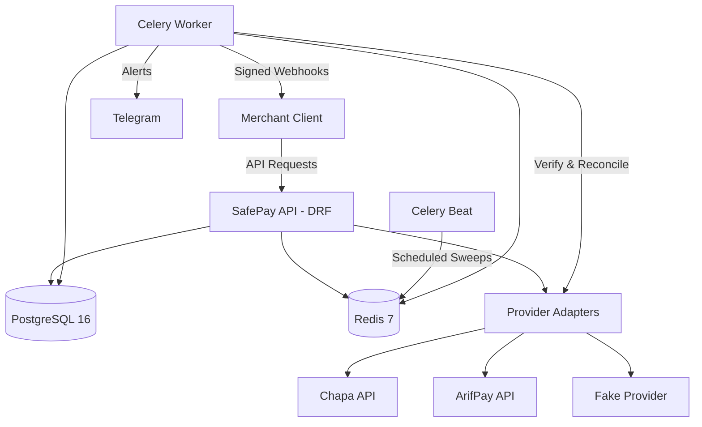

# SafePay

SafePay is a payment processing backend built with Django REST Framework for Ethiopian gateways (Chapa and ArifPay). It enforces database-level idempotency so network drops and duplicate taps never result in double charges. It provides a unified API with provider fallback, background reconciliation, a review queue, and signed webhooks.

---

## Status: Test Mode Only

SafePay is currently configured for **test mode only**. 

While live-mode architecture (`sp_live_` keys, live webhook URLs, live transaction isolation) is implemented in code, live mode is strictly gated off:
- `LIVE_MODE_AVAILABLE=False` by default; merchants require `live_enabled=True`.
- Provider adapters have `supports_livemode = False` until production contracts and compliance reviews are completed.
- Live-key requests return `403 Forbidden`, and checkout requests fail with `"No live-capable provider is configured"`.

---

## Features

- **Idempotent Payments**: DB unique constraint on `(merchant, livemode, idempotency_key)` returns cached results on replays and prevents duplicate charges on concurrent taps.
- **Merchant Accounts & Hashed Keys**: Raw keys (`sp_test_`, `sp_live_`) are shown once; only SHA-256 hashes are persisted.
- **Scoped Test & Live Keys**: Distinct key spaces authenticated via the `X-API-Key` header with live-mode permission gating.
- **Per-Merchant Webhooks & SSRF Checks**: Separate test/live webhook URLs protected by DNS-resolving SSRF validation (blocks private, loopback, and cloud metadata IPs like `169.254.169.254`).
- **Signed Webhooks with Retries**: Outbound webhooks signed with HMAC-SHA256 (`X-SafePay-Signature`) using derived per-merchant secrets, retried with exponential backoff up to 5 times.
- **Provider Adapters & Fake Provider**: Unified interface for Chapa, ArifPay, and an in-memory `FakeProvider` for offline testing and error simulation.
- **Provider Choice & Safe Fallback**: Primary provider selection with automatic fallback. Fallback executes **only** on confirmed non-creation (`not_created=True`) and halts on uncertain network timeouts to prevent double charges.
- **Checkout Sessions**: `POST /api/checkout/sessions/` starts a hosted payment session, logs audit attempts in `ProviderAttempt`, and returns a `checkout_url`.
- **Verify & Cancel**: `GET /api/payments/{id}/verify/` authoritatively syncs gateway status. `POST /api/payments/{id}/cancel/` cancels pending internal payments (provider cancellations return `409 Conflict` as gateways lack cancel APIs).
- **Background Reconciliation**: Celery Beat runs periodic sweeps with row locks (`skip_locked=True`), lease timeouts, and an 8-step backoff curve.
- **Review Queue & Telegram Alerts**: Disputed or stalled payments (`needs_review=True`) surface in a dedicated Django admin view and dispatch throttled alerts to Telegram.
- **Cursor-Paginated Payment List**: `GET /api/payments/` with tamper-proof cursor pagination and ISO-8601 date, status, and provider filtering.
- **Dockerized Stack**: Ready-to-use Compose setup with Django, Celery Worker, Celery Beat, PostgreSQL 16, and Redis 7.

---

## Architecture



---

## Provider Capabilities

| Provider | Hosted Checkout | Verify API | Inbound Webhook | Programmatic Cancel | Live Mode |
| :--- | :--- | :--- | :--- | :--- | :--- |
| **Chapa** | Yes (`/v1/transaction/initialize`) | Yes (`/v1/transaction/verify/{tx_ref}`) | Yes (HMAC-SHA256) | Planned *(unsupported by API)* | Planned *(gated off)* |
| **ArifPay** | Yes (`/checkout/session`) | Yes (`/checkout/session/{sessionId}`) | Yes *(verified via API query)* | Planned *(unsupported by API)* | Planned *(gated off)* |
| **Fake Provider** | Yes *(local mock URL)* | Yes *(in-memory store)* | Yes (HMAC-SHA256) | Yes *(in-memory)* | No *(test-only)* |

---

## Quickstart

```bash
# 1. Clone & enter repository
git clone https://github.com/SimretAbebe/SafePay.git
cd SafePay

# 2. Configure environment
cp .env.example .env

# 3. Start services with Docker Compose
docker compose up -d

# 4. Run database migrations
docker compose exec web python manage.py migrate

# 5. Create a test merchant (prints your API key once)
docker compose exec web python manage.py create_merchant --name "Demo Store"
```

### Initialize a Checkout Session
```bash
curl -X POST http://localhost:8000/api/checkout/sessions/ \
  -H "Content-Type: application/json" \
  -H "X-API-Key: sp_test_samplekey1234567890abcdef" \
  -H "Idempotency-Key: demo-idempotency-key-001" \
  -d '{
    "amount": "250.00",
    "reference": "order-101",
    "return_url": "https://merchant.example.com/checkout/complete",
    "customer_email": "customer@example.com"
  }'
```

---

## Verifying SafePay Webhooks

SafePay signs outbound webhooks using HMAC-SHA256 with the merchant's derived secret.

**Headers:**
- `X-SafePay-Event-Id`: Unique event UUID.
- `X-SafePay-Timestamp`: Unix timestamp (integer seconds).
- `X-SafePay-Signature`: Hex-encoded signature calculated over `{timestamp}.{payload_bytes}`.

**Python Verification:**
```python
from payments.webhook_verification import verify_webhook

# In your webhook endpoint (request.body must be raw bytes):
is_valid = verify_webhook(
    secret="whsec_your_derived_signing_secret",
    timestamp=request.headers.get("X-SafePay-Timestamp"),
    signature=request.headers.get("X-SafePay-Signature"),
    body=request.body,
    tolerance_seconds=300,  # Rejects timestamps older than 5 minutes
)

if not is_valid:
    return "Invalid signature or expired timestamp", 400
```

---

## Security Notes

- **Hashed Keys**: Raw keys are never stored; only SHA-256 hashes (`api_key_hash`) are persisted.
- **Derived Secrets**: Webhook signing secrets are derived deterministically on the fly (`derive_merchant_secret`) from a master secret, enabling per-merchant rotation without database migrations.
- **URL Safety Checks (SSRF Prevention)**: Target URLs must use HTTPS and are resolved to block private, loopback, and cloud metadata IPs (`169.254.169.254`). Re-checked at delivery time.
- **Verify-Before-Trust**: Inbound gateway webhooks do not mutate payment state directly; SafePay always queries the gateway's authoritative verification API before updating status.

---

## Running the Tests

```bash
# Locally:
python manage.py test

# With Docker:
docker compose exec web python manage.py test
```
*(Tests automatically run with in-memory Celery, local cache, and the fake provider enabled.)*

---

